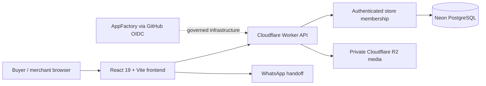

<!-- appfactory:hero:start -->
<div align="center">

# Trigenys Commerce Factory

### A storefront for every merchant. One reliable platform.

**Transform scattered social sales into branded catalogs, practical merchant workflows and buyer conversations — without pretending a WhatsApp click is a paid order.**

[](#capability-maturity)
[](#quick-start)
[](#architecture-and-trust-boundaries)
[](#architecture-and-trust-boundaries)
[](#existing-engineering-documentation)

[**Why it matters**](#why-commerce-factory) · [**User journeys**](#merchant-and-buyer-journeys) · [**Architecture**](#architecture-and-trust-boundaries) · [**Status**](#capability-maturity) · [**Run locally**](#quick-start) · [**Roadmap**](#roadmap-and-non-goals) · [**Documentation**](#existing-engineering-documentation)

</div>

---
<!-- appfactory:hero:end -->

## Why Commerce Factory

**A merchant should be able to publish a credible shop without becoming an infrastructure operator.** Commerce Factory turns a social-first catalog into a shareable storefront backed by a practical workspace. The product serves merchants selling through WhatsApp and other social channels, rather than claiming to replace checkout, delivery or accounting tools.

**Concrete scenario:** A merchant creates a shop, saves and publishes products, and shares the catalog. A buyer inspects variants, keeps a cart and submits an order request; agreement and payment remain with the merchant. A lead, request or WhatsApp click is **not** proof of a sale.

## Merchant and buyer journeys

- **Buyer:** discover a published store, inspect variants, keep a cart, send a request and revisit a private tracking page without registering.
- **Merchant:** configure the business and WhatsApp details, edit products and appearance, manage requests and view operational analytics.
- **Invited staff:** work within catalog and fulfillment rights; administration, analytics and payment confirmation remain role-restricted.
- **Support:** access tickets and limited store metadata only after an explicit platform grant.

These are the documented application journeys, not evidence that external email delivery or every production integration has been independently verified. Read [the buyer, merchant and support journey contract](docs/user-journeys.md) and [workspace UX evidence](docs/merchant-workspace-ux.md).

## Architecture and trust boundaries



The storefront and merchant workspace run in **one multi-tenant application**; creating a merchant store must not create a new deployment. The Worker owns privileged queries and checks store membership. Database credentials remain server-side. Merchant analytics distinguish product views and WhatsApp leads from merchant-confirmed completed transactions.

- [ADR-001: platform architecture](docs/architecture/ADR-001-mvp-platform.md)
- [Environments, production boundaries and deployment](docs/deployment.md)
- [Meta integration and external-token boundary](docs/integrations/meta-boundary.md)

## Capability maturity

**Stage: beta.** The repository contains implemented journeys and a production infrastructure path, alongside work that still needs operational evidence and customer validation.

| Capability | Maturity | Evidence and boundary |
| --- | --- | --- |
| Buyer, merchant, staff and support journeys | Implemented; validation ongoing | [User journeys](docs/user-journeys.md) |
| Merchant workspace and catalog interactions | Implemented; usability review ongoing | [Workspace UX](docs/merchant-workspace-ux.md) |
| Shared storefront themes | In development | [Roadmap](docs/ROADMAP.md) and [theme design](docs/architecture/ADR-002-store-theme-library.md) |
| Live merchant pilots and paid offer | Not yet established here | [Validation backlog](docs/ROADMAP.md) and [pricing transparency](docs/pricing-transparency.md) |
| Meta catalog synchronization, custom merchant domains | Planned / deferred | [Integration boundary](docs/integrations/meta-boundary.md) |

A production deployment is not proof of paid merchant adoption, end-to-end operational availability, security certification or completed payment processing.

## Quick start

**Frontend:** Node.js 24+, npm. From the repository root:

```bash
npm install
npm run dev
npm run typecheck
npm run build
```

**API:** See [backend](backend/) and the [deployment guide](docs/deployment.md) for the isolated Worker environment, provider bindings and database prerequisites. Do not place Neon, R2 or other provider secrets in frontend configuration.

**Frontend and journey test targets** include `npm run test:workspace`, `npm run test:journeys`, `npm run test:catalog` and `npm run test:themes`. Some browser and backend suites require Chromium or an isolated PostgreSQL test service; the repository CI defines the expected setup.

## Roadmap and non-goals

1. **Validate merchant value:** real beta pilots and recorded evidence of the catalog-to-conversation workflow.
2. **Stabilize the core:** shared themes, tenant-isolated media, publication and role-aware commerce operations.
3. **Evolve responsibly:** commercial plans and documented Meta integration only after the MVP proves useful.

**Not promised by this beta:** online payment custody, warehouse inventory accounting, delivery orchestration, point of sale, automatic advertising campaigns or one infrastructure deployment per merchant. See the [delivery sequence](docs/ROADMAP.md) and [pricing policy](docs/pricing-transparency.md).

## Existing engineering documentation

The repository originated from the versioned **AppFactory `react-vite` blueprint (version 1)**, using React 19, TypeScript, Vite, Node.js 24 CI and AppFactory Project Automation. The original baseline has since grown into product-specific routes, a Worker backend, domain logic and tests; it must not be described as a blank scaffold.

- [RAIDER engineering principles](docs/RAIDER.md) and [engineering contract](AGENTS.md)
- [Architecture decision](docs/architecture/ADR-001-mvp-platform.md), [delivery roadmap](docs/ROADMAP.md), [infrastructure deployment](docs/deployment.md)
- [Merchant workspace](docs/merchant-workspace-ux.md), [customer journeys](docs/user-journeys.md), [pricing disclosure](docs/pricing-transparency.md)
- [AppFactory Product README Quality](https://github.com/Trigenys/appfactory/blob/main/docs/product-readme-contract.md): declarative, idempotent and non-destructive audit of the managed introduction
- [Commerce Factory epic #1](https://github.com/Trigenys/trigenys-commerce-factory/issues/1)

No third-party security, accessibility or payment certification is claimed. Review changes through linked issues, scoped checks and verifiable Proof of Done.
